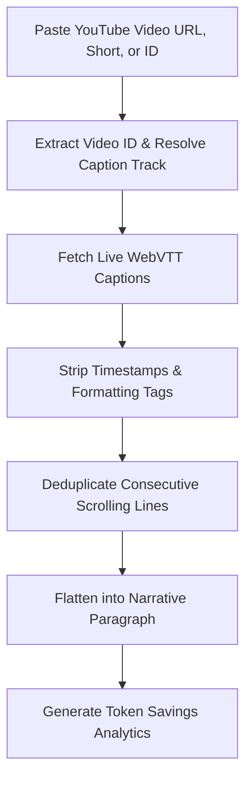

# YouTube Transcript Cleaner & Token Saver

A lightweight, high-fidelity web utility and API that converts noisy, scrolling YouTube auto-generated captions into pristine plain text. This process reduces LLM context token consumption by up to **80%**, saving cost and preventing model hallucinations.

---

## 🌟 What It Is

When you copy auto-generated captions or transcripts from YouTube, they are heavily loaded with timestamps, formatting tags (like `<c>` or `</c>`), HTML entities, and consecutive duplicated lines due to real-time caption scrolling. 

This tool cleans and optimizes these captions, returning a clean, flat narrative paragraph that is ready to be pasted directly into LLMs (like ChatGPT, Gemini, or Claude).

---

## 🧠 How It Works (High-Level)

The application cleans incoming transcripts through an automated multi-step pipeline:



1. **Direct Link Resolution**: Automatically extracts the video ID from standard URLs (`watch?v=`), short links (`youtu.be/`), Shorts, or raw 11-char IDs, and negotiates the caption track with YouTube. Legacy `timedtext` URLs are also supported.
2. **Text Cleaning**: Strips out metadata headers, timestamps, positioning attributes, and formatting tag parameters.
3. **Roll-up Deduplication**: Programmatically detects and discards consecutive redundant phrases generated by YouTube's real-time line scrolling mechanism.
4. **Paragraph Flattening**: Merges the cleaned sentences into single, readable paragraphs with optimized spacing.
5. **Token Analytics**: Estimates the original and cleaned token sizes to visualize prompt token savings.

---

## ✨ Features

- **Direct YouTube Video Link Input**: Paste standard URLs, Shorts, or IDs directly without opening DevTools.
- **Pristine Cleaning Algorithm**: Intelligently removes scrolling duplicate captions while preserving punctuation and words.
- **Vibrant Cyberpunk UI**: Features a beautiful glassmorphic dark theme, micro-animations, loading states, and quick-load sample examples.
- **Copy-to-Clipboard Utility**: One-click text copying with status animations.
- **Fast and Stateless**: Runs entirely without databases or caching requirements, optimized for Cloudflare Workers edge deployment.

---

## 🚀 Quick Start

### 1. Installation
Ensure you have [uv](https://github.com/astral-sh/uv) (a fast Python package manager) installed:
```bash
pip install uv
```

### 2. Run the Development Server
Run the local dev server using:
```bash
uv run uvicorn app.main:app --reload
```
Once started, the application is accessible at **[http://localhost:8000](http://localhost:8000)**.
